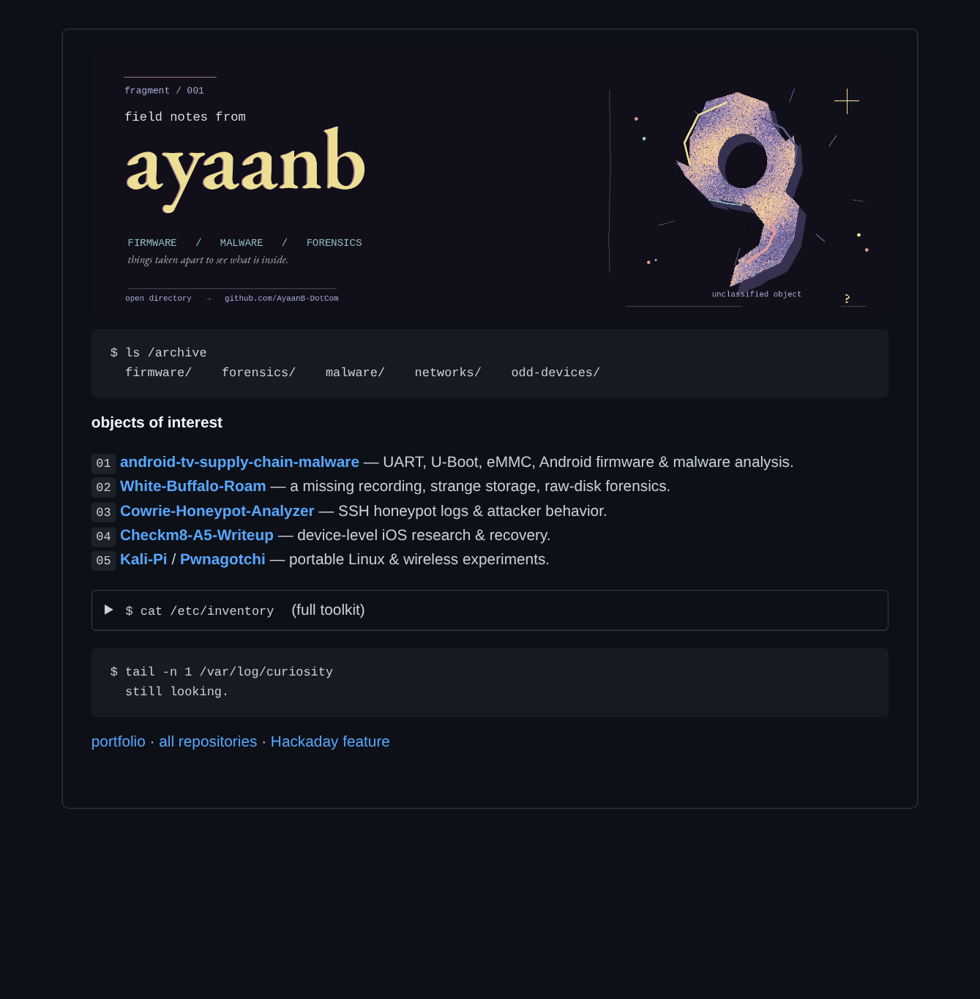

<!--
  ayaanb / fragment 001
  A handmade, static banner and an ordinary markdown index.
  No widgets, trackers, hosted badge generators, or scripts.
-->



```text
$ ls /archive
  firmware/    forensics/    malware/    networks/    odd-devices/
```

**objects of interest**

`01` **[android-tv-supply-chain-malware](https://github.com/AyaanB-DotCom/android-tv-supply-chain-malware)** — UART, U-Boot, eMMC, Android firmware & malware analysis.  
`02` **[White-Buffalo-Roam](https://github.com/AyaanB-DotCom/White-Buffalo-Roam)** — a missing recording, strange storage, raw-disk forensics.  
`03` **[Cowrie-Honeypot-Analyzer](https://github.com/AyaanB-DotCom/Cowrie-Honeypot-Analyzer)** — SSH honeypot logs & attacker behavior.  
`04` **[Checkm8-A5-Writeup](https://github.com/AyaanB-DotCom/Checkm8-A5-Writeup)** — device-level iOS research & recovery.  
`05` **[Kali-Pi](https://github.com/AyaanB-DotCom/Kali-Pi)** / **[Pwnagotchi](https://github.com/AyaanB-DotCom/Pwnagotchi)** — portable Linux & wireless experiments.

<details>
<summary><code>$ cat /etc/inventory</code> &nbsp; (full toolkit)</summary>

```text
/offensive
  OWASP Top 10 · OWASP ZAP · Burp Suite · Nmap · Metasploit
  Gobuster · Dirb · cURL · manual web-app testing · reconnaissance
  vulnerability assessment · remediation validation · CTFs · HTB · THM

/defensive
  Wireshark · PCAP · threat hunting · incident response · honeypots
  Cowrie · Wazuh · Ansible · Linux hardening · traffic analysis
  Splunk [learning] · indicators of compromise · network defense

/forensics
  Autopsy · FTK Imager · file carving · forensic acquisition
  filesystem analysis · Strings · Binwalk · hex / binary inspection
  firmware extraction · static malware analysis · reverse engineering
  Ghidra [learning] · dynamic analysis [exploring]

/hardware
  UART · U-Boot · eMMC · embedded Linux · SSH
  Raspberry Pi · Pi Zero 2 W · Pico · ESP32 · ESP32-S3
  M5 Cardputer · Flipper Zero · Alfa Wi-Fi adapters · BLE · Sub-GHz

/networking
  TCP/IP · DNS · DHCP · HTTP/S · SSH · IPv4/IPv6
  routing · switching · VLANs · Cisco IOS · Packet Tracer
  Active Directory [learning] · Kerberos [learning]

/code
  Python · Java · Bash · JavaScript · SQL · HTML5 · CSS3
  C [learning] · Assembly [learning] · React · Expo
  Git · GitHub · open-source tooling · automation · AI/LLM security
  OWASP Top 10 for LLM Applications · prompt injection research

/systems
  Kali Linux · Parrot OS · Arch Linux · Debian · Kubuntu
  openSUSE · Windows · macOS · Windows Terminal
  VMware · VirtualBox · Windows Server · Wine · AWS [learning]
```

</details>

```text
$ tail -n 1 /var/log/curiosity
  still looking.
```

[portfolio](https://ayaanb-dotcom.github.io/AyaanB-site/) · [all repositories](https://github.com/AyaanB-DotCom?tab=repositories) · [Hackaday feature](https://hackaday.com/2026/08/28/this-week-in-security-android-malware-voip-hijack-signal-contact-discovery-and-teampcp-arrests/)
